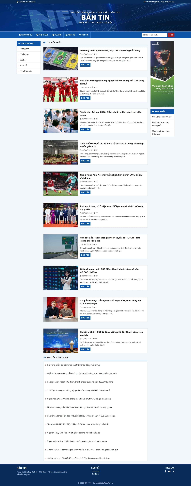
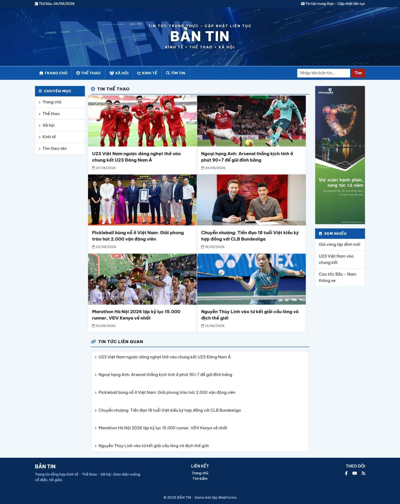
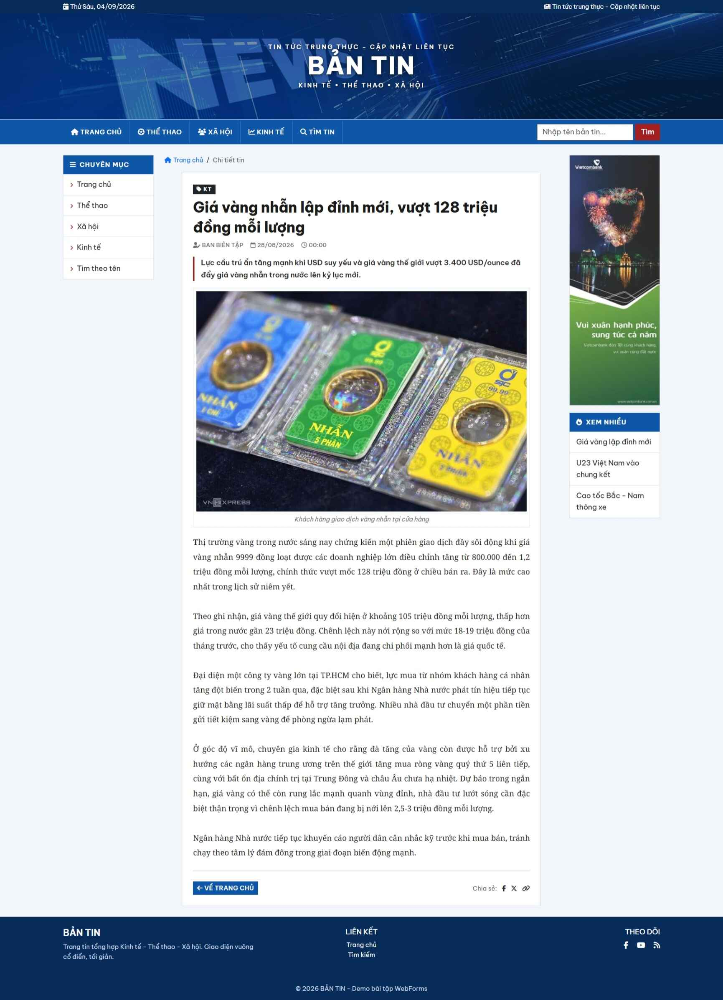
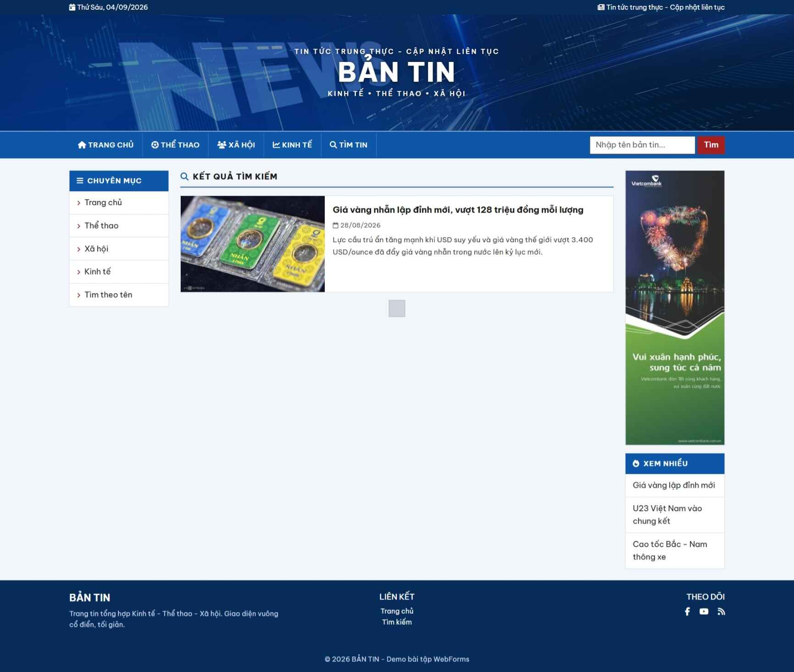

<div align="center">

# Bantin — News Portal

**ASP.NET Web Forms course project** — a news site with Economy, Sports and Society categories.

[](../)
[](#)
[](#)

**English** · [Tiếng Việt](README.vi.md) · [← Repository overview](../README.md)

</div>

---

## Features

- Home page: latest articles (sorted by publish date) plus related articles
- Category pages for Economy / Sports / Society (two-column grid) plus related articles
- Article detail page: title, publish date, image with caption, summary, body
- Search articles by title (navbar search box plus a dedicated results page)
- Connects to SQL Server through a single connection string in `Web.config`

Data lives in the `dbo.BanTin` table and is categorized by `MaLinhVuc` (`KT` = Economy, `TT` = Sports, `XH` = Society).

---

## Screenshots

| Home | Category |
|:--:|:--:|
|  |  |

| Article detail | Search results |
|:--:|:--:|
|  |  |

---

## Tech Stack

- ASP.NET Web Forms (.NET Framework 4.8.1)
- LINQ to SQL (`.dbml`)
- Bootstrap 5, Font Awesome 6.5
- SQL Server LocalDB `(localdb)\MSSQLLocalDB`

---

## Setup

1. Open `bantin.slnx` in Visual Studio 2022+ (**ASP.NET and web development** workload)
2. Create the `TinTuc` database and seed sample data:

   ```powershell
   sqlcmd -S "(localdb)\MSSQLLocalDB" -i dev\database.sql
   ```

   This script is safe to run multiple times: it creates the database if missing, creates `dbo.BanTin` if missing, then clears and re-seeds the sample articles.

3. Verify the connection string in `Web.config`:

   ```xml
   <add name="TinTucConnectionString"
        connectionString="Data Source=(localdb)\MSSQLLocalDB;Initial Catalog=TinTuc;Integrated Security=True;TrustServerCertificate=True"
        providerName="System.Data.SqlClient" />
   ```

4. Build and run (**F5**)

---

## Project Layout

| Page | Purpose |
|:--|:--|
| `Site.Master` | Master page |
| `trangchu.aspx` | Home page |
| `TrangKinhTe.aspx` / `TrangTheThao.aspx` / `TrangXaHoi.aspx` | Category pages |
| `BantinChitiet.aspx` | Article detail |
| `timbantin.aspx` / `ketquatimkiem.aspx` | Search page / results |
| `DataClasses.dbml` | LINQ to SQL mapping for `BanTin` |

Article images are stored in `image/`.
