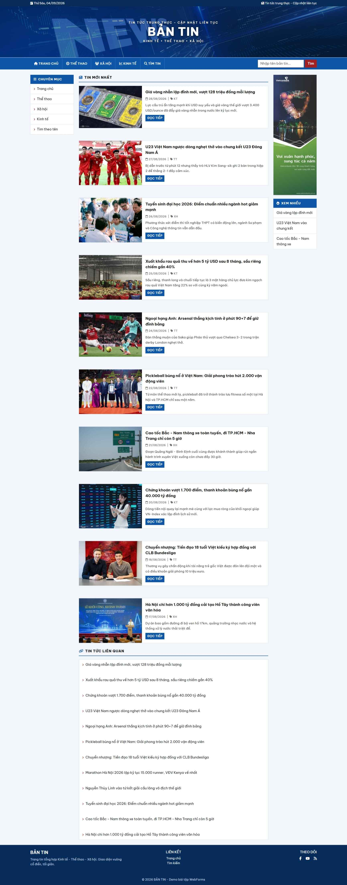
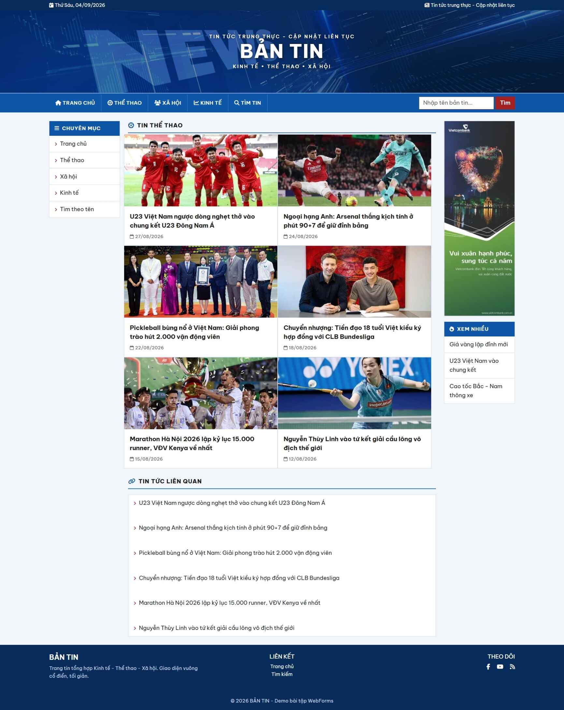
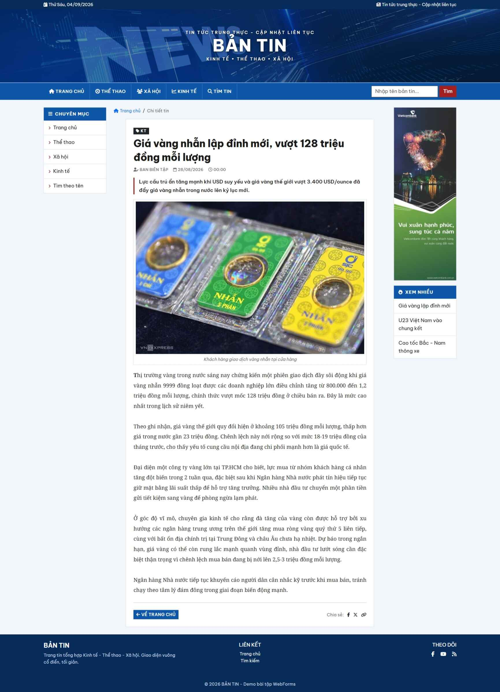
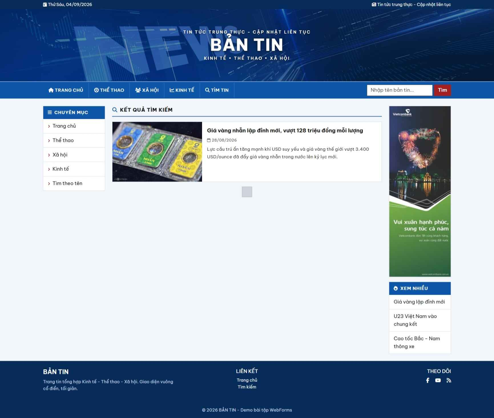

<div align="center">

# Bantin — Website tin tức tổng hợp

**Bài tập ASP.NET Web Forms** — website tin tức với các chuyên mục Kinh tế, Thể thao và Xã hội.

[](../)
[](#)
[](#)

[English](README.md) · **Tiếng Việt** · [← Tổng quan repo](../README.vi.md)

</div>

---

## Chức năng

- Trang chủ: tin mới nhất (sắp xếp theo ngày đăng) + tin liên quan
- Trang chuyên mục Kinh tế / Thể thao / Xã hội (lưới 2 cột) + tin liên quan
- Xem chi tiết bản tin: tiêu đề, ngày đăng, ảnh kèm chú thích, tóm tắt, nội dung
- Tìm kiếm bản tin theo tiêu đề (ô tìm kiếm trên navbar + trang kết quả riêng)
- Kết nối SQL Server qua một connection string duy nhất trong `Web.config`

Dữ liệu nằm trong bảng `dbo.BanTin`, phân loại qua `MaLinhVuc` (`KT` = Kinh tế, `TT` = Thể thao, `XH` = Xã hội).

---

## Giao diện

| Trang chủ | Chuyên mục |
|:--:|:--:|
|  |  |

| Chi tiết bản tin | Kết quả tìm kiếm |
|:--:|:--:|
|  |  |

---

## Công nghệ

- ASP.NET Web Forms (.NET Framework 4.8.1)
- LINQ to SQL (`.dbml`)
- Bootstrap 5, Font Awesome 6.5
- SQL Server LocalDB `(localdb)\MSSQLLocalDB`

---

## Cài đặt

1. Mở `bantin.slnx` bằng Visual Studio 2022+ (workload **ASP.NET and web development**)
2. Tạo database `TinTuc` và seed dữ liệu mẫu:

   ```powershell
   sqlcmd -S "(localdb)\MSSQLLocalDB" -i dev\database.sql
   ```

   Script an toàn khi chạy nhiều lần: tạo database nếu chưa có, tạo bảng `dbo.BanTin` nếu chưa có, sau đó xóa và seed lại dữ liệu mẫu.

3. Kiểm tra connection string trong `Web.config`:

   ```xml
   <add name="TinTucConnectionString"
        connectionString="Data Source=(localdb)\MSSQLLocalDB;Initial Catalog=TinTuc;Integrated Security=True;TrustServerCertificate=True"
        providerName="System.Data.SqlClient" />
   ```

4. Build và chạy (**F5**)

---

## Cấu trúc trang

| Trang | Mục đích |
|:--|:--|
| `Site.Master` | Master page |
| `trangchu.aspx` | Trang chủ |
| `TrangKinhTe.aspx` / `TrangTheThao.aspx` / `TrangXaHoi.aspx` | Các trang chuyên mục |
| `BantinChitiet.aspx` | Chi tiết bản tin |
| `timbantin.aspx` / `ketquatimkiem.aspx` | Trang tìm kiếm / kết quả |
| `DataClasses.dbml` | LINQ to SQL mapping cho bảng `BanTin` |

Ảnh minh họa bản tin lưu trong `image/`.
